# Before and after

**Current** is the alpha release candidate: the Electric Garden build, simulator screenshots from `claude/alpha-integration` (`docs/product/screens/alpha-rc/`). That is the most advanced version that exists, so the comparison is against Kinship at its best, not against main. **Proposed** is the prototype in this folder: browser renders, design evidence only.

The test for each surface is the founder's: *is it structurally different, or the old structure with a new skin?*

---

## 1. Today

<figure>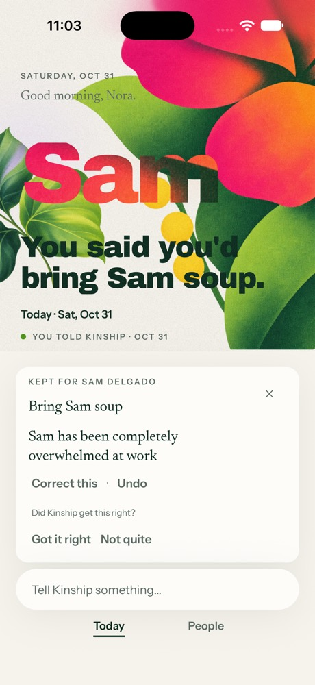<figcaption>Current · one moment, Kept card, Tell</figcaption></figure><figure>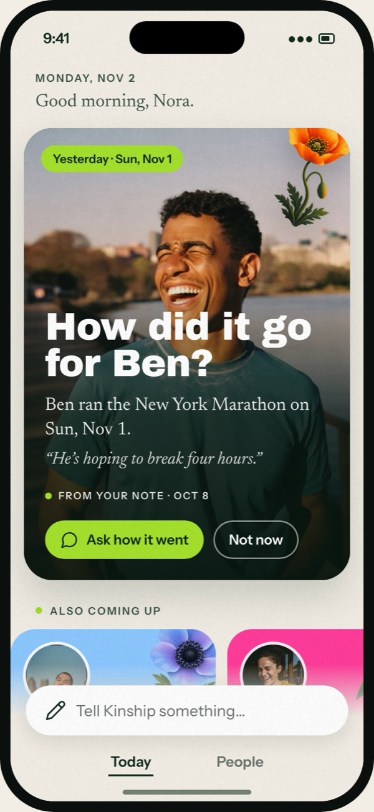<figcaption>Proposed · poster + a deck that ends</figcaption></figure>

| | |
|---|---|
| **Structural change** | Today goes from a single headline with stacked text blocks to a **finite deck**: one poster, then the week as swipeable cards, then "That's today." The poster **expands in place** into the moment. Before, the line opened a detail sheet over a page that didn't move. |
| **Visual** | The person is the composition: a full-bleed photo, or a type poster with their color and flower. Before, the flower was the composition and the name was decoration. Supporting items get clearly lower weight (smaller, circular portrait, day as the headline). |
| **Usability problem solved** | Current Today reads as text about a person, and anything past the one moment is a list of quiet lines below the fold. The deck makes "what else this week" glanceable without endless scroll, and the end card says you're done. |
| **Why more compelling** | You see *who* first, then *why*, then the source. Opening Kinship feels like seeing a friend, not reading a reminder. |
| **Must stay intact** | `today-eligibility.md` as written: one primary, the threshold of 55, the per-person cap, the quiet-line rules, "Nothing needs you today" only when nothing is waiting, first use ≠ quiet day, return check above the moment, Not now. |

<figure>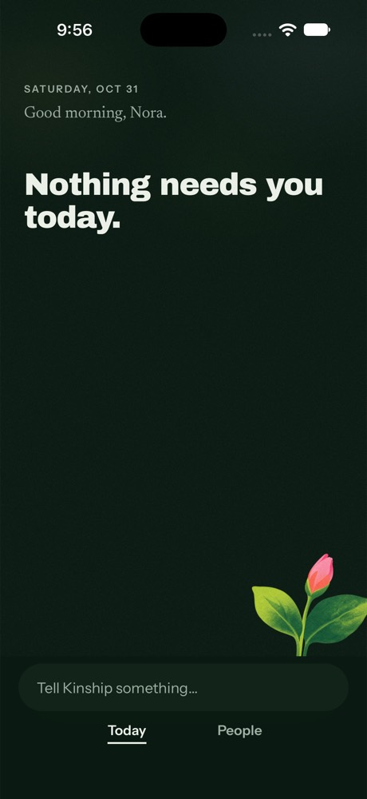<figcaption>Current · quiet day</figcaption></figure><figure>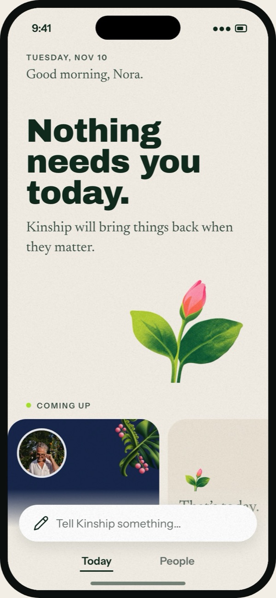<figcaption>Proposed · quiet day, still a deck</figcaption></figure>

<figure>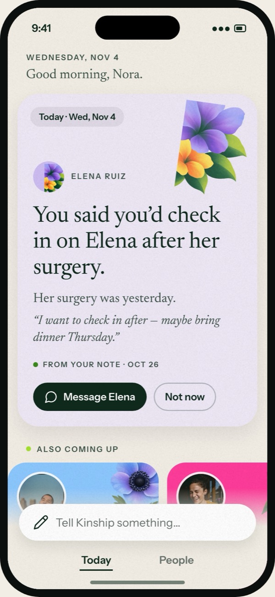<figcaption>Proposed · a hard time: quieter poster</figcaption></figure><figure>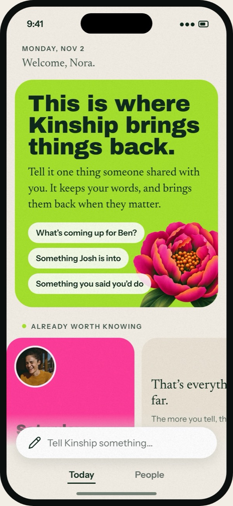<figcaption>Proposed · first run: orients, never empty</figcaption></figure>

## 2. The moment, and showing up

<figure>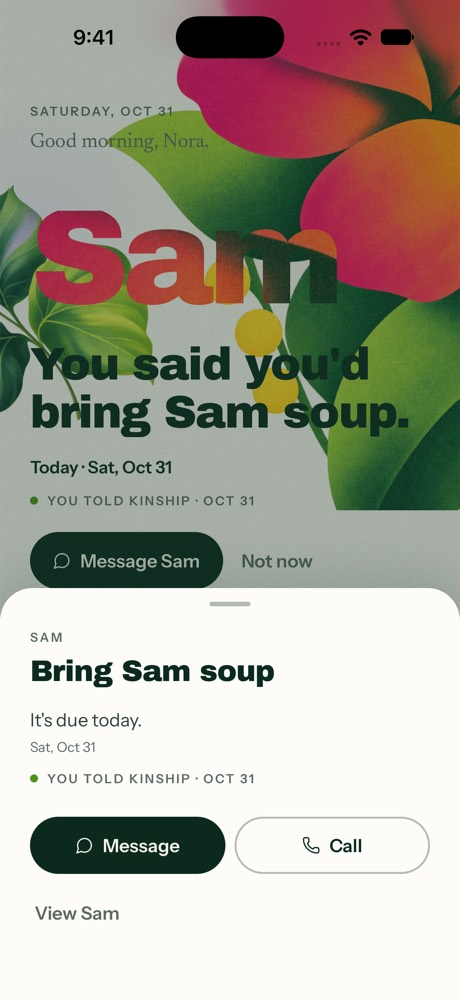<figcaption>Current · Moment detail sheet</figcaption></figure><figure>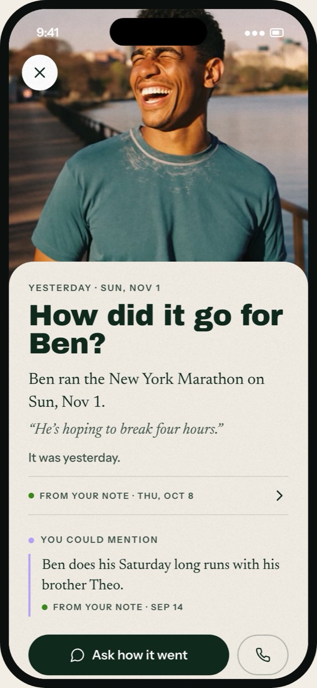<figcaption>Proposed · the poster expands</figcaption></figure>

<figure>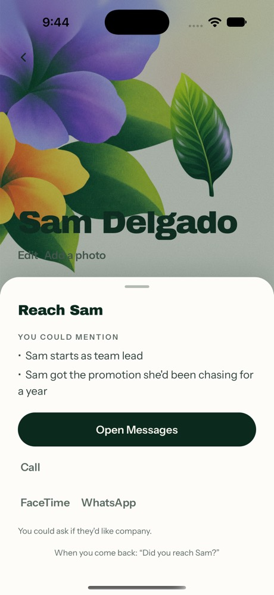<figcaption>Current · hand-off sheet with the SUA-1 line</figcaption></figure><figure>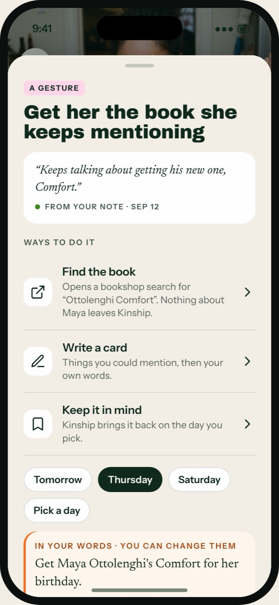<figcaption>Proposed · one grounded idea, ways to do it</figcaption></figure>

| | |
|---|---|
| **Structural change** | Showing up stops being a line under a button and becomes a **place**: the expanded moment's "Ideas for showing up". Each idea opens an assist sheet that shows its grounding (your words, with their source) and the **ways to do it**: Message, Call, *Help me start* (on request), *Keep it in mind* (an intention in your words, with a day), and later a plain *Find it* hand-off. |
| **Visual** | Ideas are cards with a category (a gesture, time together, practical help, follow through) and an italic quote of what you said. SUA-1's line is plain grey text under the sheet. |
| **Usability problem solved** | The current SUA-1 line is generic ("You could ask if they'd like company.") and appears under a moment the user didn't ask about. That is exactly the founder's 19 Oct points 1 and 2. Here every idea is specific *because* it quotes the memory ("keeps talking about getting his new one, Comfort"), and nothing appears until the user taps "Ideas for showing up". |
| **Why more compelling** | It shows Kinship's real advantage (it knows what *this* person said) and turns intention into one tap of real help, without ever doing it for you. |
| **Must stay intact** | D9 (never sends; openers only on request), T12 (a hand-off alone is never contact), CC-28 safeguards (no commerce, nothing bought or booked; doing nothing is fine), SUA-1 exclusions (no sensitive or relative lines, nobody paused or remembered), content-free outcome measurement. |

<figure>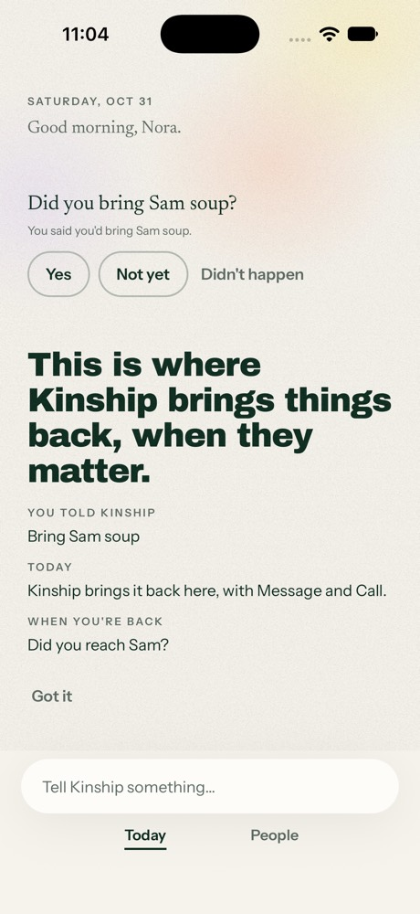<figcaption>Current · return check</figcaption></figure><figure>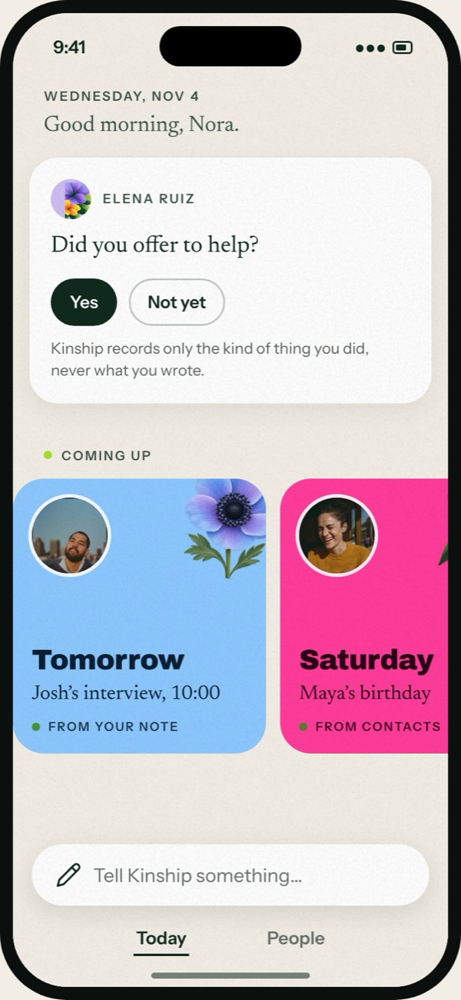<figcaption>Proposed · after Yes, one outcome question</figcaption></figure>

## 3. People

<figure>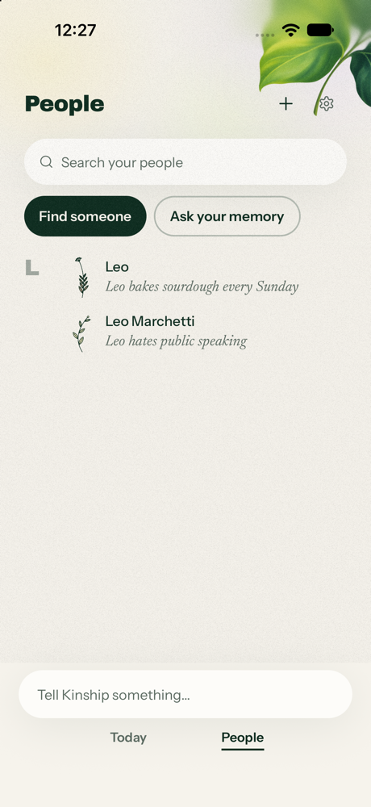<figcaption>Current · search-first A–Z list</figcaption></figure><figure>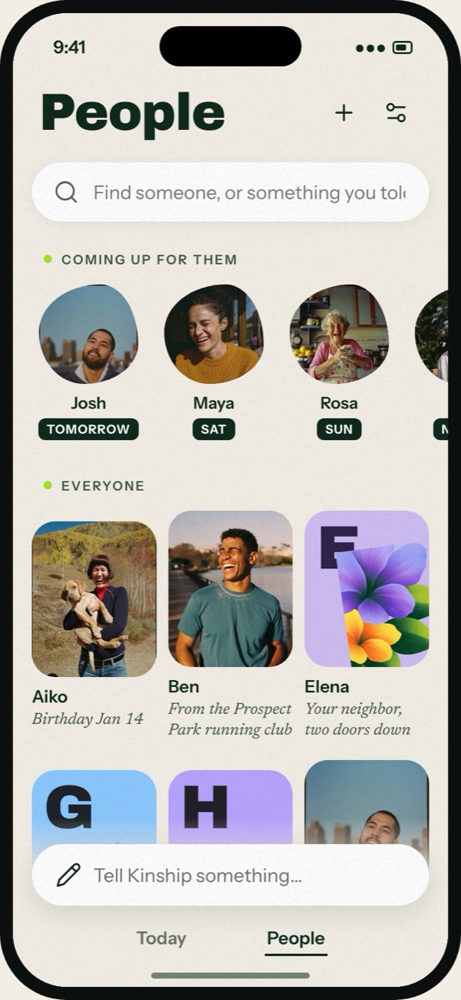<figcaption>Proposed · date band + equal portraits</figcaption></figure>

<figure>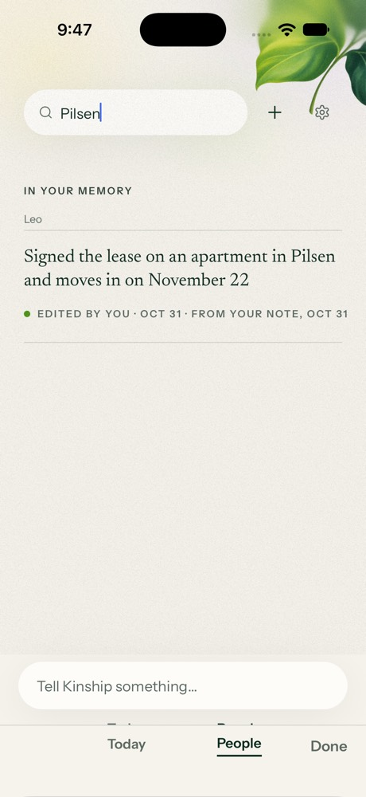<figcaption>Current · Ask your memory (separate mode)</figcaption></figure><figure>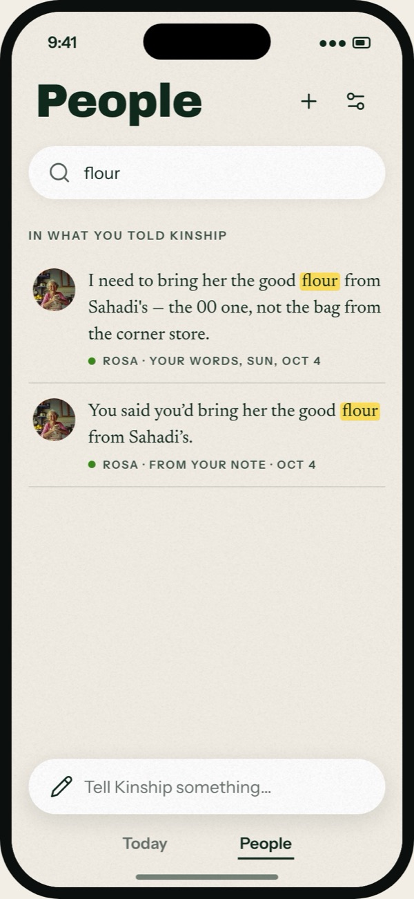<figcaption>Proposed · one field: names and your words</figcaption></figure>

| | |
|---|---|
| **Structural change** | From a list of rows (sprig, name, one line) to a **portrait index**: a "coming up for them" band ordered by date only, then equal tiles A to Z. "Find someone" and "Ask your memory" become **one field** that returns people and then your own words with their dates. |
| **Visual** | Portrait-led tiles. People without photos get their initial, color and flower: distinct and equal, never grey placeholders. |
| **Usability problem solved** | The current list makes everyone look the same and hides what's coming. Two buttons split one intent ("find"). The tiles carry recognition; the band answers "who has something soon" without ranking anyone. |
| **Why more compelling** | It looks like your people, not your contacts. And it needs nothing from you: no groups, no arranging, no pins. |
| **Must stay intact** | Nothing ordered by closeness, importance or contact recency (rule 3). Only picked people. Add by name and from Contacts. Bring back. Remembered and Paused states. **T4 needs a founder override** (see Decisions). |

## 4. Person

<figure>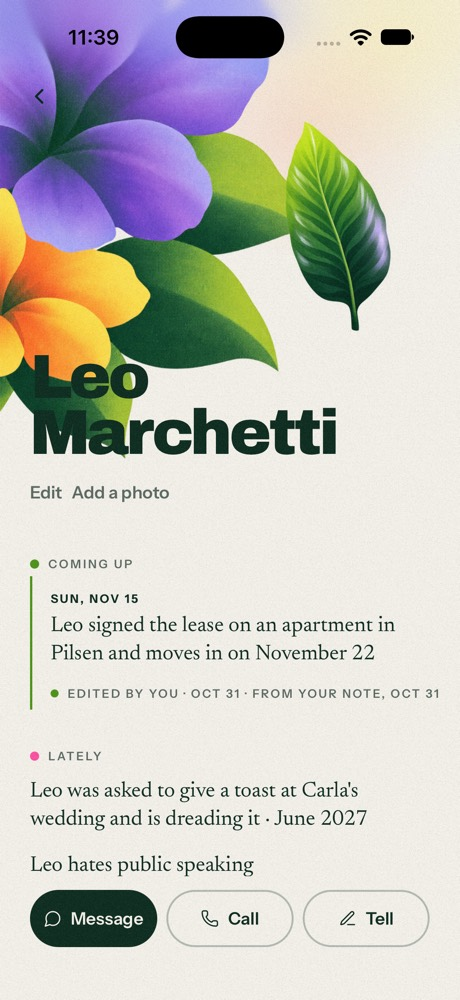<figcaption>Current · Portrait sections</figcaption></figure><figure>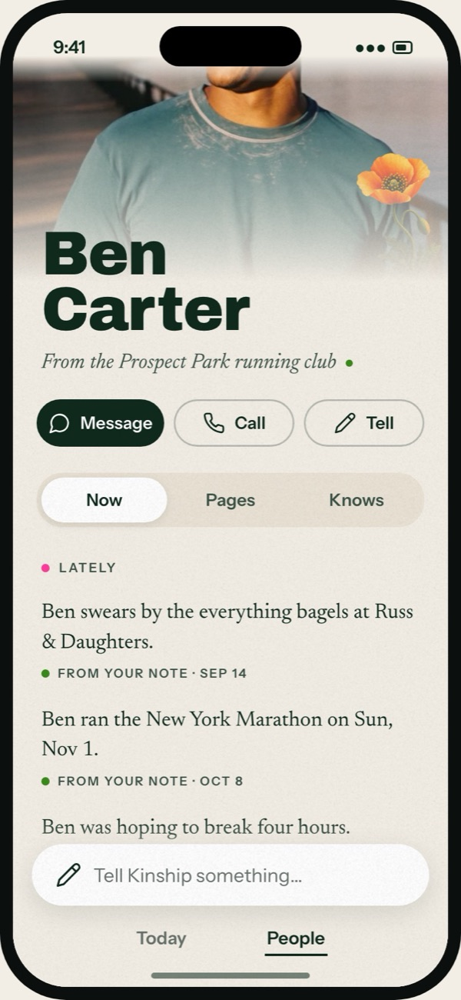<figcaption>Proposed · notebook, three lenses</figcaption></figure>

<figure>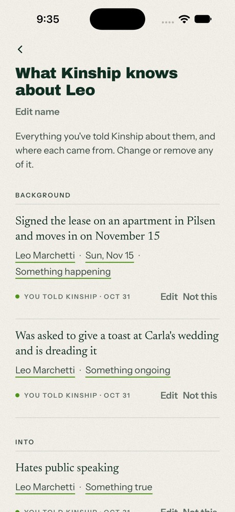<figcaption>Current · What Kinship knows (separate screen)</figcaption></figure><figure>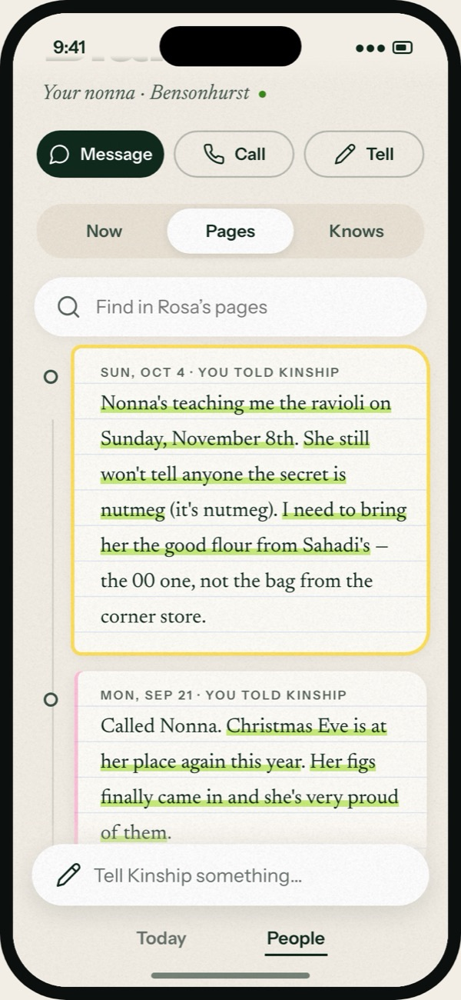<figcaption>Proposed · Pages: your words, over time</figcaption></figure>

<figure>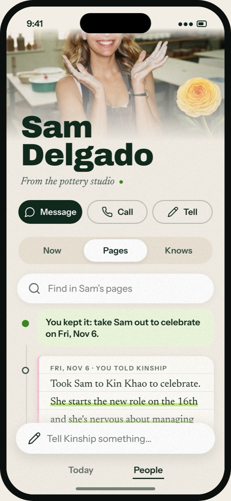<figcaption>Proposed · what you did, in the notebook</figcaption></figure><figure>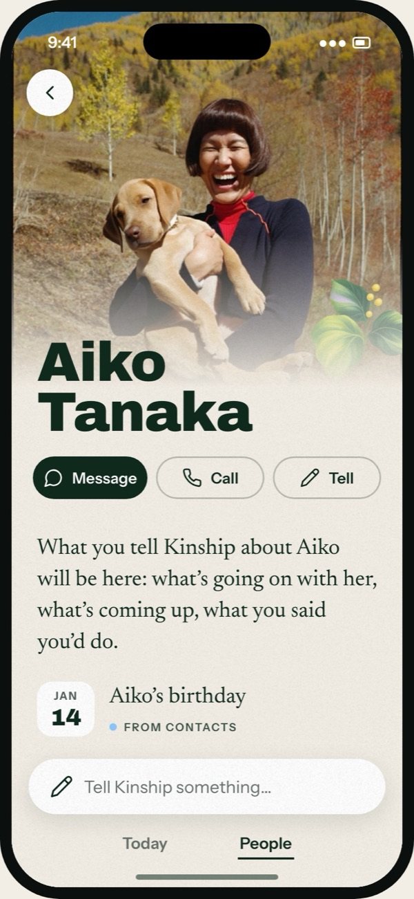<figcaption>Proposed · sparse person, invitation only</figcaption></figure>

| | |
|---|---|
| **Structural change** | One scroll of sections (Coming up, Lately, then a link to a separate What Kinship knows screen) becomes **one notebook with three lenses**: **Now** (the Portrait), **Pages** (every note about them, exact, with kept phrases highlighted and your actions interleaved) and **Knows** (the organized reference, formerly its own screen). Each line lives in one lens. |
| **Visual** | Each person has their own portrait or type header, color and flower. Pages use ruled paper with a margin and highlights. What you did appears as green "You kept it" and "You messaged" entries on the same timeline as what you were told. |
| **Usability problem solved** | Today the user's own words are only reachable one line at a time through Source. The relationship's story (told, then acted on, then told again) is invisible. And the same facts appear on the Portrait and in What Kinship knows. |
| **Why more compelling** | It finally feels like *your notebook about Rosa*: you can reread what she said and when, and see that you showed up. |
| **Must stay intact** | `relationship-page-rules.md` (sections, caps, time order, residence de-duplication, someone else's promise, conversations), Edit, Not this, Before / was, sensitive lines private, the empty-page invitation. |

## 5. Tell

<figure>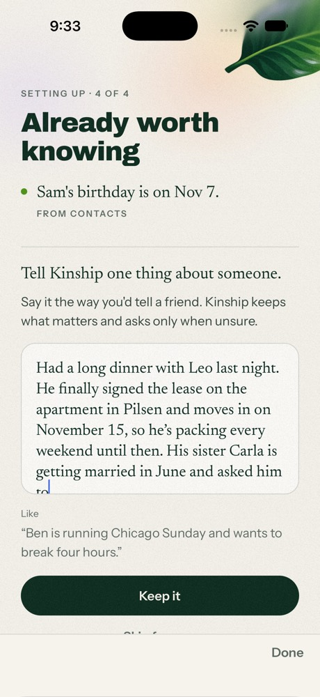<figcaption>Current · Tell field (first Tell)</figcaption></figure><figure>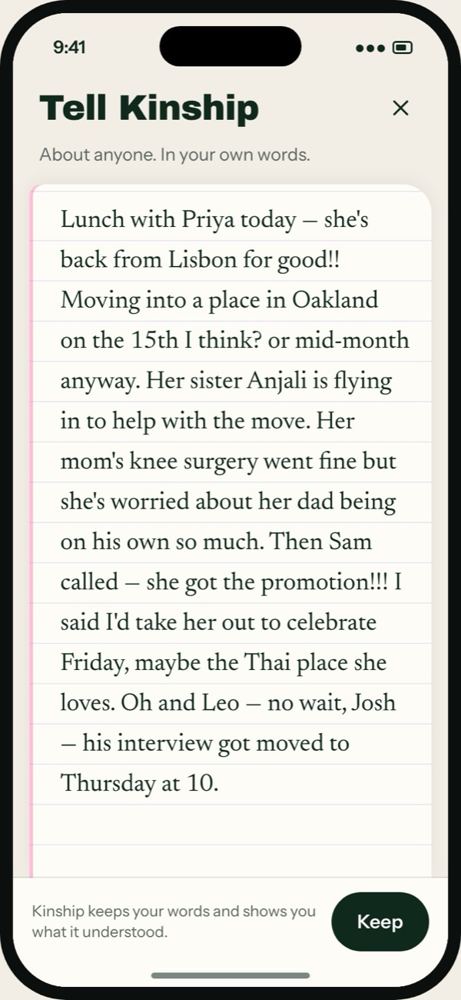<figcaption>Proposed · a page to write on</figcaption></figure>

| | |
|---|---|
| **Structural change** | A full-height ruled page instead of a field. After Keep, **understanding sweeps under your own words** in each person's color, and the review opens with your words still on top. |
| **Visual** | Ruled paper, a margin line, a serif at reading size. No mic, because there's no on-device voice yet (D5). |
| **Usability problem solved** | A small field invites short, tidy notes. The research shows that long, messy, several-person notes are the real input. The page signals that messy is fine. |
| **Why more compelling** | It's the notebook's front door, and the sweep shows "I read *this* part" before any list. |
| **Must stay intact** | Same pipeline: consent first, long notes read in passages, no silent caps (founder direction 19 Oct), keyboard dictation not called voice. |

## 6. Review and correction

<figure>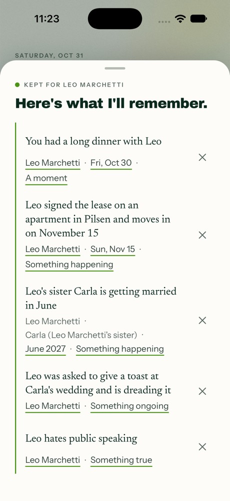<figcaption>Current · lines with tokens</figcaption></figure><figure>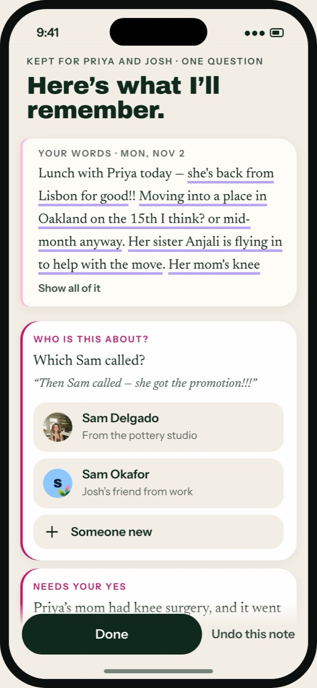<figcaption>Proposed · your words on top, questions first</figcaption></figure>

<figure>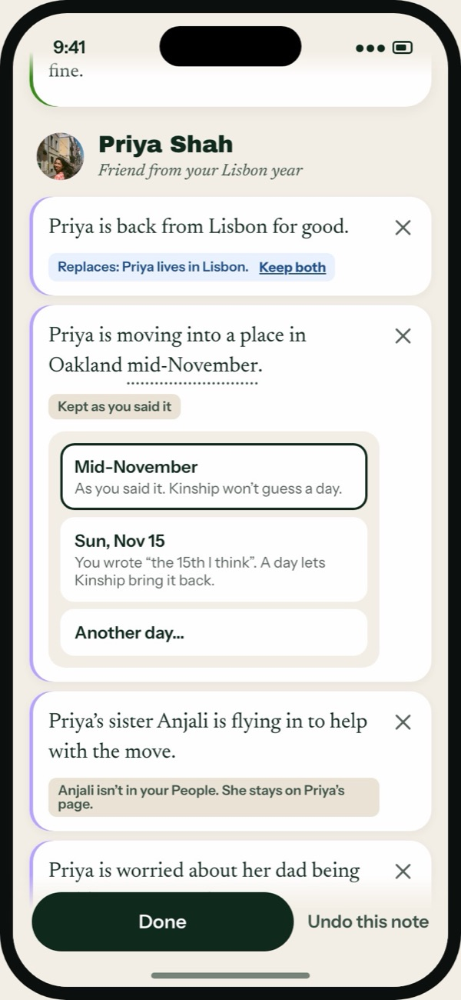<figcaption>Proposed · a vague date kept as said; one tap to pin it</figcaption></figure><figure>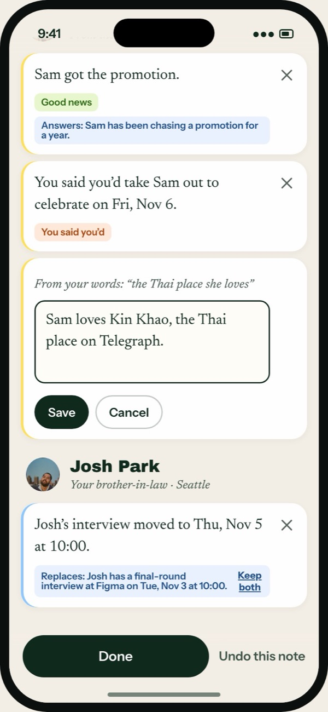<figcaption>Proposed · correct the sentence, your words beside it</figcaption></figure>

| | |
|---|---|
| **Structural change** | The review now keeps **your words above the understanding**, with each understood phrase underlined in its person's color. Tap a phrase to jump to its line; tap a line to flash its words. Questions ("Which Sam?") and sensitive readings come first. Lines are grouped by person. A line is corrected **in place**: tap a date token for a small picker, tap the sentence to edit it with your original words shown beside it. |
| **Visual** | Readable sentences with a person-colored edge. Kind tokens ("Something happening") are gone; quiet tags only where they matter (Replaces …, You said you'd, Good news, Already known, Kept as you said it). |
| **Usability problem solved** | Today's review is a column of lines with underlined tokens and no link back to the words. With nine lines from one note, users can't tell where each came from or which one is wrong. |
| **Why more compelling** | It makes Kinship's rarest property, that every line traces to your words, visible at the moment of trust. |
| **Must stay intact** | Clear lines save with Undo; sensitive and two-candidate readings wait; told again → Replaces with Keep both; already known → nothing added twice; × (Not this) never deletes the note; Undo removes the whole note; the user's edit wins. |

---

## Competitive patterns: borrowed vs distinctly Kinship

| Pattern | Source in PR #76 | Borrowed as a proven convention | Distinctly Kinship |
|---|---|---|---|
| Review before saving | Keep, YourPond, remember them | ✓ review exists, and Undo | Your words stay on screen, mapped phrase ↔ line; sensitive readings need a yes |
| Several people from one story | Keep, YourPond | ✓ grouped by person | Who-is-who asks instead of guessing; vague dates stay vague |
| Follow-ups from what you said | Keep ("Ask Hannah how the move went") | ✓ event follow-ups | Your **own promise** returns as a moment; "I did this" closes it; nothing goes overdue |
| Finite daily surface | Tend's "caught up", Bond, grug | ✓ an end card | Grounded in a real reason or nothing ("Nothing needs you today") |
| Poster / Contact-poster composition | Apple Invites, Contact Posters | ✓ full-bleed person poster | Type poster with identity flower for photo-less people; tender variant for hard times |
| Portrait grid | CatchUp, Kinu, Fabriq | ✓ equal tiles | Never arranged, scored or grouped; band ordered by date only |
| Help with what to say | Dex, Mesh (drafts) | — | Ideas quote the memory; openers only on request; never sends (D9) |
| Gift or event ideas | Mesh Nexus, YourPond gifts | — | Only from what *this* person told you; no catalogue, no commerce (CC-28) |
| After-contact capture | Queue (Mac logging) | ✓ prompt right after | "Anything worth remembering?" goes into the same review with "Already known" |
| Source per answer | ChatGPT memory sources | ✓ provenance visible | Per line, per person, permanent; the Pages lens is your notebook |
