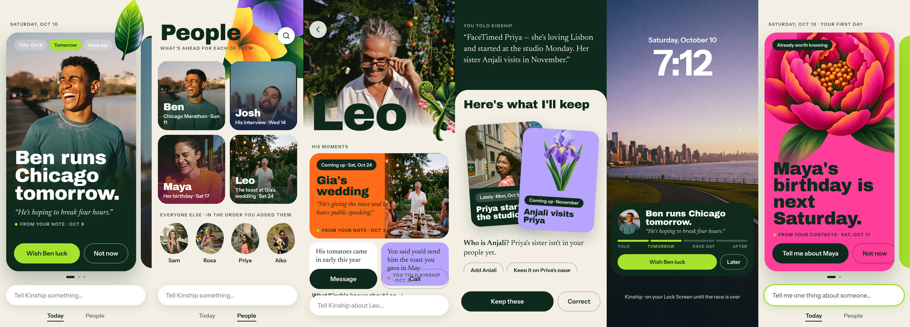
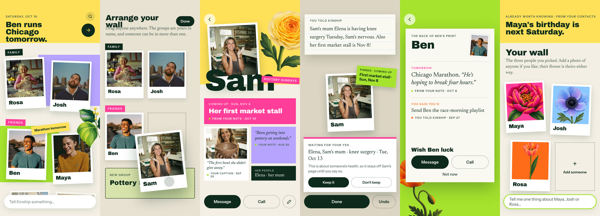
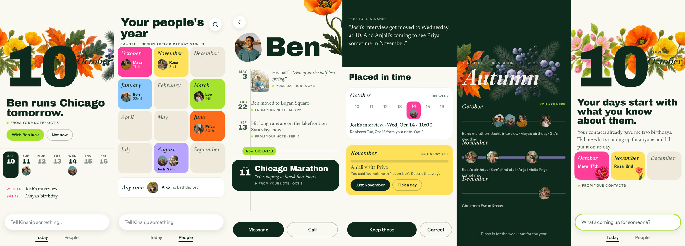
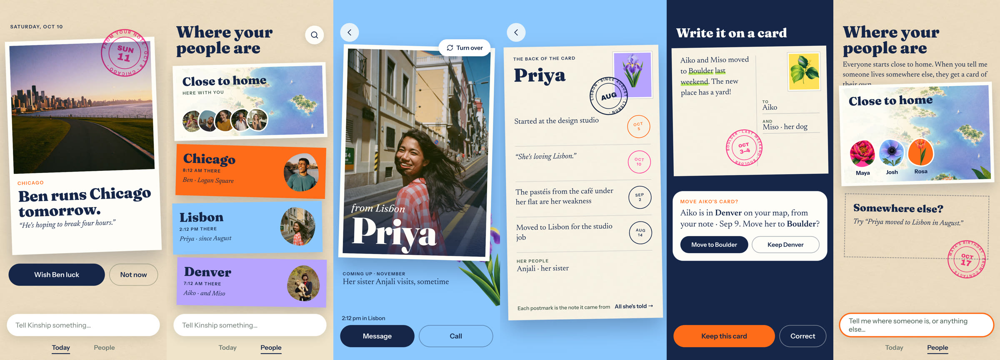
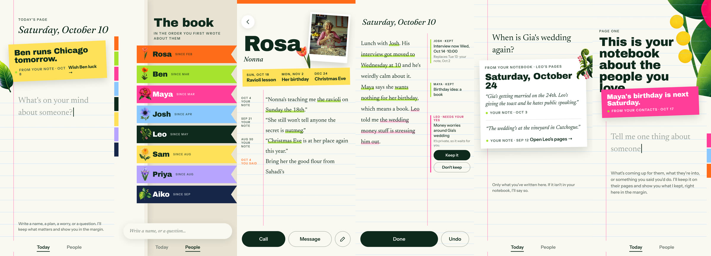

# Five whole-app structures (31 Oct 2026)

**Status: EXPLORATION · UNAPPROVED · design only.** No product code, schema, gateway, flag, coverage row or decision register changed. WS-2's in-flight structural pass (FD-30j) and the other workstreams were not touched. Readiness: NOT READY (nothing here is built).

**The canvas:** <https://claude.ai/artifact/EjaKVc9DDD9mPsKVgboByC> (private until shared). An Overview page holds the problem, a side-by-side comparison, the research and the assets. Each option has its own page of six phone screens, linked for Play. The canvas source is in [`canvas/`](canvas/), and stills of every screen are in [`screens/`](screens/) (`overview-*.jpg` shows each option's six screens in one row).

## For reviewers

The canvas link is private, so review from the stills in [`screens/`](screens/). Each option has one row image showing its six screens in this order: Today, People, a person, Tell with its review, the option's signature state, and first run on a fresh account. Every screen is also available as its own file. The canvas source in [`canvas/`](canvas/) has the exact copy and layout.

Please judge three things:

1. Is each option a real structural change, or only a reskin of the old list?
2. Does any screen break a rule in `CLAUDE.md` or `docs/product/KINSHIP_2_PRODUCT_CONTRACT.md`? The most likely places are:
   - quantifying a relationship
   - showing AI
   - a statement with no source
   - a sensitive reading going ahead without a yes
   - a fresh account landing on an empty Today or People
3. Is my recommendation sound? It is under "The five options" below.

| Option | Six screens |
|---|---|
| 1 · Moment Deck |  |
| 2 · The Wall |  |
| 3 · The Almanac |  |
| 4 · The Atlas |  |
| 5 · The Notebook |  |

Overview boards: [problem](screens/Main.jpg) · [side by side](screens/Compare.jpg) · [research and sources](screens/Research.jpg) · [assets](screens/Assets.jpg).

## Why this exists

The founder reviewed the integrated build on 31 Oct and found that People still renders a search field, an A–Z list, the same sprig beside each person, and a name with one line. It is the old structure with a new skin, and the same is true of every page. The brief was a deep investigation built from real references and real assets, ending in five different whole-app options.

## What the research found

Two research passes covered about 85 sources (apps, Apple Design Award winners 2023–2026, personal CRMs, craft write-ups). The full source list with links is on the canvas's Research board.

1. **The trap.** Every personal CRM (Clay, Dex, Garden, Fabriq, Covve, UpHabit) is a contact list plus a reminder cadence. The "humane" ones (Poppy's wilting plants, Dunbar's closeness rings, hey!'s streaks) only restyle the cadence. This is the reskin the founder keeps seeing, and it also breaks contract rule 3.
2. **One dominant object per screen.** Strong precedents give each view one hero taking at least half the screen. Lists sit one gesture away: Photos' pinch, Weather's list. Google's Material 3 Expressive research also warns that scattering things for style breaks recognition, so reading order is kept.
3. **Less time in the app.** Flighty's Live Activities, Locket's widget-as-product and grug's one finite page a day are the strongest precedents for Kinship's anti-engagement stance.

## The five options

| # | Option | Primary object | People ordered by | Signature |
|---|---|---|---|---|
| 1 | **The Moment Deck** | a moment with a lifecycle | date of each person's next moment; the rest in the order added | Today is a few full-bleed posters that end; it lives on the Lock Screen |
| 2 | **The Wall** | a face (one equal print per person) | the user's hand, in groups the user names | one surface, no tabs; Today is a tag pinned to a face |
| 3 | **The Almanac** | a day | birthday month | pinch between week, season and year; Tell lands on its date |
| 4 | **The Atlas** | a place | place, as the user told it | each person is a postcard; every source is a postmark |
| 5 | **The Notebook** | a page | when the user first wrote about them | understanding appears in the margin beside the user's words; Ask is writing a question |

Each option shows Today, People, a person, Tell with its review, one signature state and first run on a fresh account. First run uses only contact birthdays and the people the user picked; no option seeds anything.

**My read, not a decision:** options 1 and 2 are the strongest, and they combine well, with the Deck as Today and the Wall as People. The Notebook's margin review is worth adopting whichever is chosen. The Almanac and the Atlas work better as lenses inside another structure than as the whole app.

## Rules kept in every screen

- A source on every statement.
- One primary action, plus Not now.
- The user's words in quotation marks.
- Sensitive readings wait for a yes (Elena's surgery; Leo's money worries).
- Ambiguous dates stay as told ("sometime in November").
- A told-again change asks whether it replaces the old one.
- Nothing counted, ranked or scored.
- No AI anywhere.
- The Electric Garden look (FD-30b).
- Same-size prints and blooms, which carry identity only.

## Decisions these need from the founder

- **T4 (People search-first and alphabetical).** Every option retires it, and each puts People on a field other than closeness. This is a contract §6 override, and the founder must record it.
- **Option 1:** widening FD-30e's private notification to a Live Activity.
- **Option 2:** user-named, many-to-many groups. This is already the "explore later" direction in coverage row 30.
- **Option 4:** place as an organising field. It would be built only from what the user told Kinship, never from contact addresses (T8) or live location.
- **Option 5:** Tell (the page) as home.

## Assets and provenance

All images were generated on 31 Oct 2026 through the workspace's image connector, from prompts written for Kinship, with no reference image from the mood boards or any third party. Every person is fictional sample imagery standing in for photos a user would choose. This round cost about 22 credits.

| Asset | Model | Job |
|---|---|---|
| Maya portrait | Soul 2.0 | `de4f4365-6790-47ea-9822-62c717d7ba74` |
| Josh portrait | Soul 2.0 | `3fdd9d8c-4b64-43ae-8a34-a1b51b9e653f` |
| Sam portrait | Soul 2.0 | `b523eb72-73f1-4a87-a2e0-2f05fa094562` |
| Leo portrait | Soul 2.0 | `7bfad8a3-928e-419a-9740-c6dc18246cfa` |
| Rosa portrait | Soul 2.0 | `cccf09ae-44cb-471e-81b2-6a1a5383d3f2` |
| Priya portrait | Soul 2.0 | `f3f4ad1f-1705-441e-a883-27960c27e8c5` |
| Aiko portrait | Soul 2.0 | `2448ad4d-5681-4d83-8424-ddc85bb27ca2` |
| Maya's birthday (identity from her portrait) | Nano Banana | `cafeb2e6-2620-409d-a04c-65fc46cce7fb` |
| Leo's toast (identity from his portrait) | Nano Banana | `11668827-7b42-4064-9ac7-f3c966c9db62` |
| Sam's bowl (identity from her portrait) | Nano Banana | `cc7a0f6f-5856-401c-93e8-2de2d27a3a3d` |
| Chicago lakefront | Soul 2.0 | `a1428c59-074f-4376-926b-994f284fa4d1` |
| Peony | gpt-image 2.5, transparent | `a8b5dc34-80f0-492b-babd-b7828bfb4747` |
| Poppy | gpt-image 2.5, transparent | `e56777c6-b47d-42d0-9863-bd2528e24afd` |
| Iris | gpt-image 2.5, transparent | `ea27690e-5a70-4668-8c5b-db2dc7381dad` |
| Ranunculus | gpt-image 2.5, transparent | `1ba6cc25-2198-471f-9a56-2e6683f13b98` |
| Fern and monstera | gpt-image 2.5, transparent | `48a72f98-171f-42e1-8f09-565ddfd9e8b1` |
| Tulip (regenerated) | gpt-image 2.5, transparent | `b68078c0-6129-4e63-b138-24dbdc77d8e5` |
| Anemone (regenerated) | gpt-image 2.5, transparent | `721c71fe-aeb2-4b97-9dc3-bb3e64a03094` |
| Illustrated map | gpt-image 2.5 | `99c0bbff-97fb-4252-9272-efe993c93443` |
| Seasons garland | gpt-image 2.5, transparent | `155867f6-44f7-42ba-9309-7fdc4b1c6b39` |

**Rejected:** a first tulip and a first anemone, both because of glow halos. Their jobs are `d7f7aa01-…` and `7d4efa4c-…`.

**Reused:** Ben's three photos and the paper texture come from the Stage 1 creative reset (`claude/kinship-creative-reset`). The corner blooms, leaves, bud and grain come from WS-2's `assets/images/garden/` (see its `PROVENANCE.md`).

**Fonts:** Archivo Black, Fraunces, Instrument Sans and Newsreader, all from Google Fonts under the SIL OFL.

## How the stills were made

The canvas artboards are `.dc.html` files. To check each screen before publishing, a local script stripped the runtime wrapper, pointed `/_blob/` URLs at local copies (`canvas/assets-map.txt`), and rendered each screen with headless Chrome at 2×. The stills are browser renders of design mockups, which is design evidence only. They are not native evidence.
